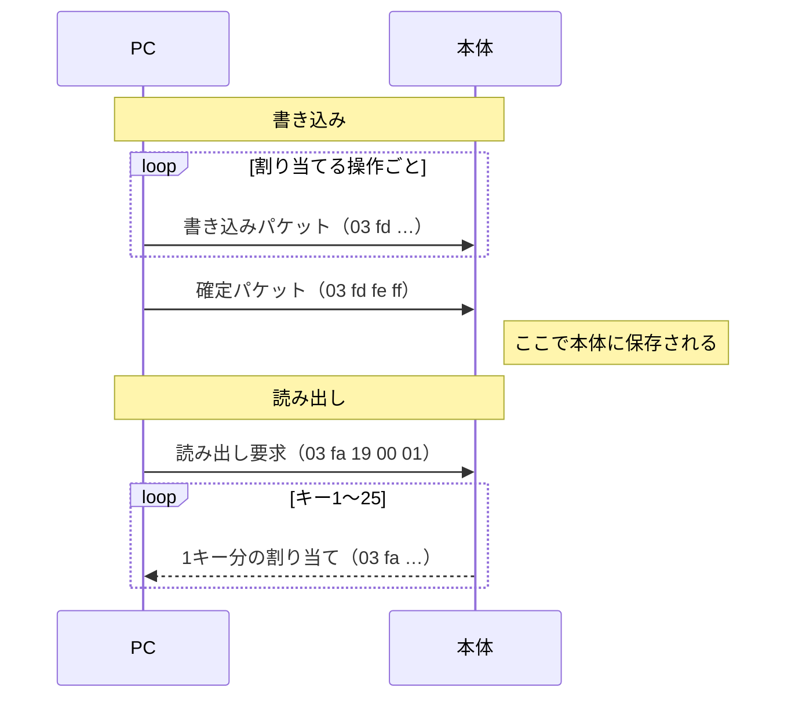

# 通信の仕様

二層ノブ（USB ID `514c:8850`）の割り当てを読み書きするときの、USB 通信の中身をまとめたもの。

## 全体の流れ



## 通信の窓口

本体は USB 上に2つの窓口（インターフェース）を持っている。

| 番号 | 役割 |
|---|---|
| 0 | **設定用**。ここに読み書きのパケットを送る |
| 1 | 入力用。ノブを操作したときのキー入力やマウス操作が、ここから PC に届く |

Linux では、設定用の窓口が `/dev/hidrawN`（N は番号）として見える。どれが設定用かは、`/sys/class/hidraw/hidrawN/device/report_descriptor` の先頭が `06 00 ff` かどうかで見分けられる。このツールは自動で探す。

## パケットの形

やり取りするパケットは、どれも **65バイト固定**。先頭1バイトが種別（レポートID）で、いつも `03`。残り64バイトが中身で、使わない部分は `00` で埋める。

## キー番号

本体の中では、操作ごとに番号が振られている。読み書きでは、この番号で操作を指定する。

| キー番号 | 操作 | 設定ファイルでの名前 |
|---|---|---|
| 1 | 不明（工場出荷時は Enter） | なし |
| 2 | 上のノブを左に回す | `upper.left` |
| 3 | 上のノブを押す | `upper.press` |
| 4 | 上のノブを右に回す | `upper.right` |
| 5 | 上のノブを押しながら左に回す | `upper.press_left` |
| 6 | 上のノブを押しながら右に回す | `upper.press_right` |
| 7 | 下のノブを左に回す | `lower.left` |
| 8 | 下のノブを右に回す | `lower.right` |
| 9〜25 | 未使用（ボタンが多い別の製品向け） | なし |

## 書き込み

1つの操作につき、次のパケットを1つ送る。

| 位置 | 値 | 意味 |
|---|---|---|
| 0 | `03` | レポートID（固定） |
| 1 | `fd` | 書き込みコマンド |
| 2 | 例 `03` | キー番号 |
| 3 | `01` | レイヤー。この製品はレイヤー1しか使わない |
| 4 | `00`〜`03` | 割り当ての種類。0=なし、1=キーボード、2=メディア、3=マウス |
| 5〜 | | 割り当ての中身（種類によって違う。次の節で説明） |

全部の操作を送り終えたら、最後に**確定パケット** `03 fd fe ff`（残りは `00`）を送る。

### 割り当ての中身と「グループ」

割り当ての中身は、**3バイトひと組の「グループ」** を並べて表す。グループは `00 00 <値>` の形で、3バイト目に値が入る（キーボードの場合は、先頭2バイトにキーを押す間隔が入ることもある）。

中身の先頭2バイトは、そのあとにグループがいくつ続くかを表す。グループの並びは、種類ごとに次のように決まっている。

#### キーボード（種類 1）

| 位置 | 内容 |
|---|---|
| 5 | `00` |
| 6 | グループの数 |
| 7〜 | 押すキーを1つずつグループにしたもの |

Ctrl などの修飾キーは、それ自体を1つのグループにして、修飾したいキーの直前に置く。修飾キーの値は Ctrl=`f1`、Shift=`f2`、Alt=`f3`、Win=`f4`。ほかのキーの値は USB の標準キーコード（A=`04`、Enter=`28`、Space=`2c` など）。

例：`ctrl+c` を上のノブの押し込み（キー番号3）に割り当てる

```
03 fd 03 01 01 00 02  00 00 f1  00 00 06
                  │  └ Ctrl ┘  └ C  ┘
                  └ グループ2つ
```

#### メディア（種類 2）

| 位置 | 内容 |
|---|---|
| 5〜6 | `00 02`（グループ2つ） |
| 7〜9 | `00 00 <コードの下位バイト>` |
| 10〜12 | `00 00 <コードの上位バイト>` |

コードは USB のメディア操作用コード。主なものは、音量アップ=`00e9`、音量ダウン=`00ea`、ミュート=`00e2`、再生/一時停止=`00cd`、次の曲=`00b5`、前の曲=`00b6`。

例：ミュートを上のノブの押し込みに割り当てる

```
03 fd 03 01 02 00 02  00 00 e2  00 00 00
```

#### マウス（種類 3）

| 位置 | 内容 |
|---|---|
| 5〜6 | `01 04`（修飾のグループ1つ＋操作のグループ4つ） |
| 7〜9 | 修飾キー（`00` ならなし） |
| 10〜12 | ボタン。左=`01`、右=`02`、中=`04` |
| 13〜15 | 横の移動量 |
| 16〜18 | 縦の移動量 |
| 19〜21 | ホイール。上=`01`、下=`ff`（-1） |

例：下のノブの左回し（キー番号7）を上スクロールにする

```
03 fd 07 01 03 01 04  00 00 00  00 00 00  00 00 00  00 00 00  00 00 01
```

#### 割り当てなし（種類 0）

ヘッダだけを送り、残りは全部 `00` にする。

```
03 fd 05 01 00
```

## 読み出し

次のパケットを送ると、本体がレイヤー1の全キー（1〜25）の割り当てを、1キーにつき1パケットで返してくる。

```
送信: 03 fa 19 00 01
       │  │  │  │  └ レイヤー
       │  │  └──┴ 25キー分を要求
       │  └ 読み出しコマンド
       └ レポートID
```

返ってくるパケットは、書き込みとほぼ同じ形をしていて、2バイト目が `fa` になっている。

```
03 fa 03 01 02 01 02 00 00 e2
      │  │  │
      │  │  └ 種類（メディア）
      │  └ レイヤー
      └ キー番号
```

位置5のバイトは、書き込んだ値と違うことがある。本体はこのバイトを使用していないとみられ、動作には影響しない。

## 押し込みの制限

上のノブを押すと、本体は離した瞬間に「押す→離す」をまとめて送る。押しながら回す操作と区別するため、離すまで判定を保留していると考えられる。
割り当ての種類をマウスに変えても、押しながら回すを「なし」にしても、この動きは変わらなかった。本体の制御プログラムの仕様だから、通信では変えられない。

## 調べ方

- 書き込みの形式は、[ch57x-keyboard-tool](https://github.com/kriomant/ch57x-keyboard-tool) の [PR #191](https://github.com/kriomant/ch57x-keyboard-tool/pull/191) に書かれていた形式を参考にした
- 読み出しの方法と、確定パケットの形は、メーカー配布の Mac 版アプリを `tools/macho.py`（実行せずに中身を逆アセンブルするツール）で解析して調べた
- キー番号と操作の対応は、実機から読み出した工場出荷時の値と、実際に書き込んで反応を見た結果から決めた
